# Outcome Lab, the brand and website for a new consultancy

This is the brand and the website I designed and built for Outcome Lab, a new
AI-native technology and transformation consultancy. It has the logo and the
brand kit, a seven page website with a lot of scroll-driven motion, a section
for articles and a contact form, all running on Next.js and Vercel.

**Live: [outcomelab.co.uk](https://outcomelab.co.uk)**

**Status:** delivered, live in production and maintained by me.

## My role

I did the design and the implementation. That means:

- **The brand.** I made the logo, the colours and the brand kit.
- **The website design.** I designed every page myself, in a PDF that became
  the reference for the code.
- **The build.** I turned the founders' ideas into the actual pages: the
  layout, the components, the animations, the content structure, SEO and the
  mobile version.

None of this was done alone in a corner. The founders were consulted all the
time and approved every step, from the logo to the last headline change.

The project had one more person on it. **Serban** took care of the repository,
bought the domain and built the contact functionality (the form handler and
the emails). Everything else in this case study is my work.

## About the project

Outcome Lab is a new initiative started by two co-founders. I met them while
volunteering at the **Leaders in Tech** organisation. Their idea is a
consultancy that gets paid for measurable business results, not for billable
hours: every engagement starts with an "Outcome Contract" that says what has to
change and how it will be measured, and the work is done by small senior teams
with AI agents built in. They work in three markets: Romania, the United
Kingdom and Saudi Arabia.

They had the business ideas, but they needed a creative perspective to show
those ideas to the world and keep going with the business development. A
company like this has nothing to show yet in the beginning, no case studies and
no client logos, so the website has to explain the model clearly and make it
feel real. That's where I came in.

What the site has right now:

- **7 main pages:** home, what we do, Outcome Kit (their 5 step method), how we
  work, industries, about and contact.
- **Outcome Notes,** a section for articles, with its own page for each note.
- **An investors page** with a short deck request form, linked only from the
  footer.
- **Privacy and legal pages.**
- **Generated files:** the social share image, the icons, the sitemap and
  robots.txt are all built at build time.

In numbers: about 7,000 lines of TypeScript and CSS, 31 components and 12
routes.

## Design and brand

- **Logo:** an arrow with a dotted path going up to it, and the "Outcome"
  wordmark with a blue dot. The dotted path comes back on the site as a
  progress ring.
- **Colours:** ink, white and one blue, `#3C78FD`, used only as a marker,
  never as a fill. Two extra shades of it keep small text above WCAG AA
  contrast.
- **Typography:** Archivo for headings, Inter for everything else.
- **Brand kit:** seven SVG versions of the logo, each with notes on where to
  use it and its minimum size.
- **Website design:** a PDF with all seven pages, which the design tokens in
  the code follow.

## Stack

**Frontend:** Next.js 16 (App Router) with React 19, TypeScript, Tailwind CSS
v4 (with its default colour palette removed, so only the brand colours exist)
and CSS Modules for the more complex components.

**Motion:** Lenis for smooth scrolling. Everything else is written by hand with
`requestAnimationFrame`, `IntersectionObserver`, `ResizeObserver` and CSS
animations. No animation library.

**Hosting:** Vercel, which builds and publishes the site on every push.

**Fonts:** self-hosted from the repo (Latin subsets only). No request ever goes
to Google Fonts, and the site sets no cookies, so it doesn't need a cookie
banner.

I didn't use a UI kit. The design is very specific and it was easier to build
it myself than to fight a component library.

## Engineering highlights

### From one landing page to seven pages

The first version of the site was one long landing page split into chapters.
As the founders' ideas got clearer there was too much to say on one page, so
in October I redesigned it. I rebuilt the home page first, with the scroll
hero, a motion system, new sections and a dark footer. Then I moved all the
inner pages to the same visual system, so the whole site feels like one thing.

### The computer that zooms with the scroll

The home hero has a desktop computer whose screen shows an Outcome Contract
next to a chart. It's not an image or a video. It's built in HTML and SVG at
720 x 580, so the text on the screen is real text and comes from the same
content file as the rest of the site.

On phones and tablets the screen plays a 10 second CSS loop: the cursor clicks
"Sign contract", the signature writes itself, the line on the chart climbs from
the baseline to the target and a "Target met" label pops up.

On desktop (from 1024px) the scroll drives everything. As you scroll, the
computer grows until its screen covers the whole view, and the story on the
screen moves with your scroll instead of playing on its own. "Target met" lands
right when the screen fills the view. Then a white gradient goes down over it
and the next section comes in.

A few things I had to solve here:

- **The same animation, two ways.** I didn't want to write the screen
  animation twice. In the scroll version the CSS animations are paused and get
  a negative `animation-delay` based on the scroll, so the loop is "frozen" at
  the exact point the scroll asks for. Same CSS, two behaviours.
- **Sharp text at every size.** At the end the computer is more than three
  times bigger than at the start. If I scaled it with `transform: scale()`, the
  browser could scale it like a picture and the text would come out blurry. So
  on every frame the drawing is laid out again at the size it's shown (CSS
  `zoom`) and only moved with a transform. That's also why it faces you
  straight on and doesn't tilt.
- **Different screen sizes.** The resting position depends on where the
  headline ends, which changes when the font loads, so a `ResizeObserver`
  watches it. On short laptop screens, if the cards after the hero are taller
  than the view, the hero adds extra scroll so you can still reach them all.
  The scroll hero first started at 1280px. Later I brought it down to 1024px,
  with a smaller computer at rest so it doesn't touch the numbers next to it.
- **Accessibility.** The computer is one image for screen readers, with a
  label. The intro that appears at the end is only a visual copy, and the real
  one comes right after the hero in the page.

### The Outcome Kit orbit

The Outcome Kit is the founders' five step method: Diagnose, Define, Design,
Deliver, Demonstrate. I wanted the steps to feel like a cycle, not a list, so on
the home page they are five cards orbiting the title on an ellipse.

The orbit turns with the scroll. The section stays pinned under the header,
each step comes to the front and stays there for a moment, then the orbit
turns to the next one. A row of markers below shows which step you're on. The
orbit follows the scroll with a little easing, and the easing uses the real
frame time, so it feels the same on 60Hz and 120Hz screens. The cards at the
back are never under 86% opacity, so their text stays readable.

On phones the orbit becomes a carousel you swipe, with scroll snapping and the
same markers. With reduced motion it's a simple grid.

On the Outcome Kit page there is a second orbit in the hero: the five names
turning on a tilted ring, in real 3D. That one is pure CSS. Each label runs the
same rotation with its own head start (a negative delay), and its face turns
back against the ring so the text always faces you.

### Traditional consulting vs. Outcome Lab

The founders' main message is "this is how consulting works today, and this is
what we do differently". I made it a switch. The list starts as "Traditional
consulting": billable hours, large project teams and so on. When you switch to
"Outcome Lab", each row gets crossed out one after the other and the new answer
appears next to it with a blue tick. Switch back and it goes in reverse.

Nothing happens by itself. Until someone uses the switch, its other side pulses
softly and a small hint points at it. For screen readers the switch has
`aria-pressed`, the list is `aria-live`, and each new row is read as
"Billable hours, replaced by Defined outcomes".

### A motion system with rules

With this much motion it was easy to end up with a site that feels busy, so I
set some rules and built them into the code:

- **Four motion tokens** (fast, base, slow, stagger) for every transition. With
  `prefers-reduced-motion` they all become 0, so everything stops at once.
- **No load animations.** Content below the fold fades in when you scroll to
  it, but anything already on screen when the page loads is left alone. The
  text never depends on JavaScript to be visible.
- **Loops pause off screen.** Anything that loops (the computer, the floating
  cards, the typing caret) has a `data-ambient` mark, and one observer pauses
  it when it's not visible.
- **The logo as a progress ring.** Each section label has the dotted circle
  from the logo with the section number inside. Its twelve dots light up one by
  one as you read through that section.
- **Smooth scroll that behaves.** Lenis smooths the mouse wheel but leaves
  touch native, and it turns itself off with reduced motion. Later I found that
  Next.js keeps the scroll position between pages when part of the new page is
  already in view, so leaving a long page near the end dropped you on the
  footer of the next one. Now every route change goes back to the top, except
  for back/forward and `#anchor` links.

### All the text in one file

Every word on the site lives in one file, `site.ts`, grouped by page and
section. The components have no text in them. This made working with the
founders much faster: when they want to change a sentence, it's one line in
one file and a push. The articles work the same way: a new note with
`status: "published"` gets listed, gets its own page and goes into the sitemap
automatically.

### SEO and link previews

Every page has its own title and description, and there's structured data for
the organisation and the website. The share image (1200 x 630) is generated at
build time with the hero headline, the logo and the same Archivo font, so it
always matches the site. Its URL follows the Vercel production domain, so
LinkedIn or WhatsApp always get the preview from the current deploy. The site also sends basic
security headers and hides the `X-Powered-By` header.

## Performance and accessibility

Lighthouse 13.5 on the live site, 27.10.2026 (home, what we do, Outcome Kit,
contact):

| | Performance | Accessibility | Best practices | SEO |
|---|---|---|---|---|
| Desktop | 99 to 100 | 92 to 100 | 100 | 100 |
| Mobile | 85 to 92 | 96 to 100 | 100 | 100 |

No layout shift (CLS 0, and 0.002 on the home page on desktop). LCP is 0.5 to
0.6 s on desktop and 2.5 to 2.8 s on Lighthouse's slow 4G mobile simulation.

There are still things to fix, and I'd rather say them here:

- On the home page Lighthouse flags two small accessibility issues: an
  `aria-label` on a paragraph (the typed "AI speed." line) and the contrast of
  the small step numbers on the cards at the back of the orbit.
- On mobile the Total Blocking Time is 180 to 330 ms, because of the
  JavaScript for the animations. That's the next thing I want to improve.

What's already in place: the three shades of blue checked for contrast, a
"Skip to content" link, visible focus outlines, `prefers-reduced-motion`
respected in every animation and the decorative parts hidden from screen
readers.

## Screenshots

### Home

| | |
|---|---|
| 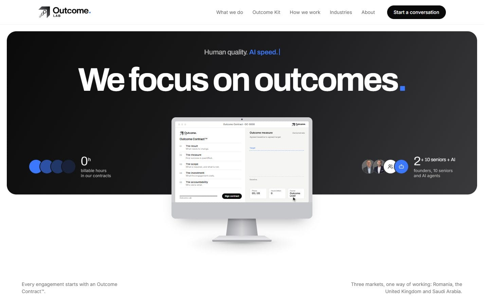 | 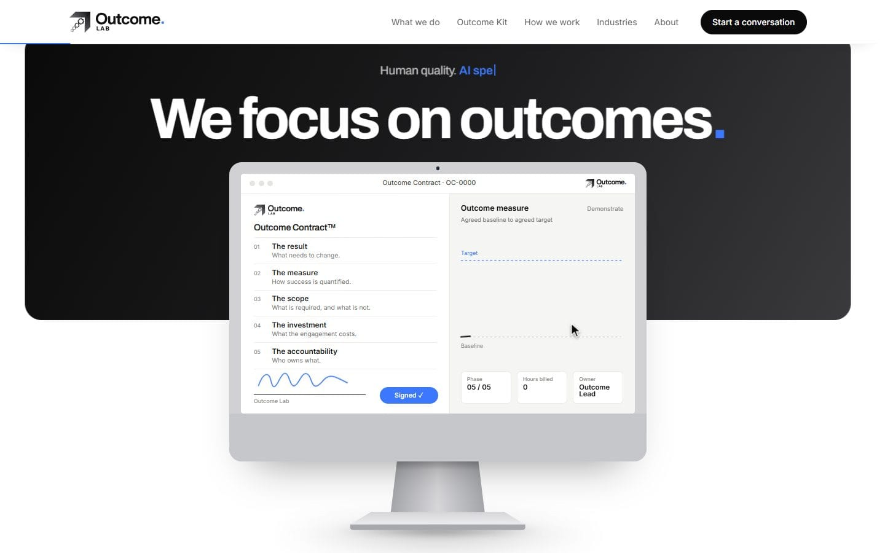 |
| **Hero.** The headline, the two numbers and the computer at rest. | **Scrolling.** The computer grows and the contract gets signed. |
| 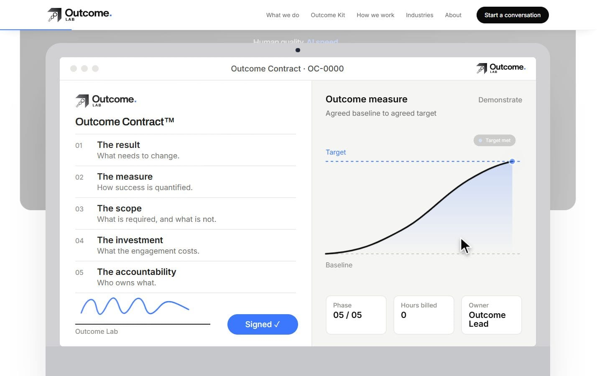 | 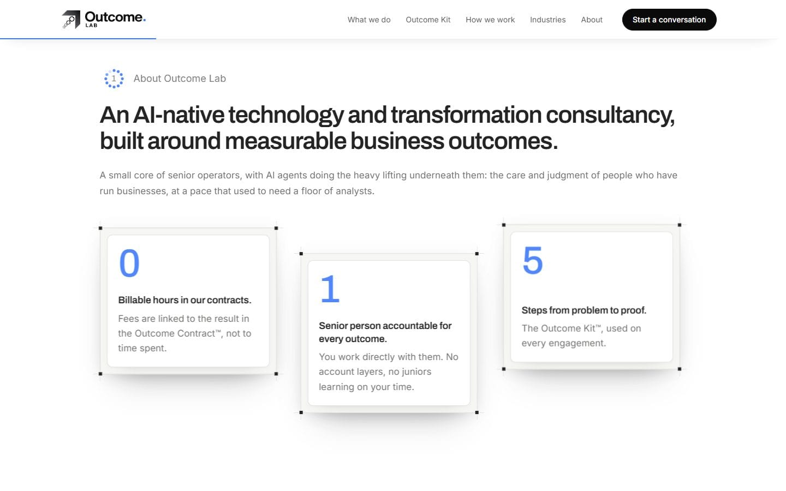 |
| **Target met.** The screen almost fills the view and the chart reaches the target. | **The intro.** What comes in after the white gradient. |
| 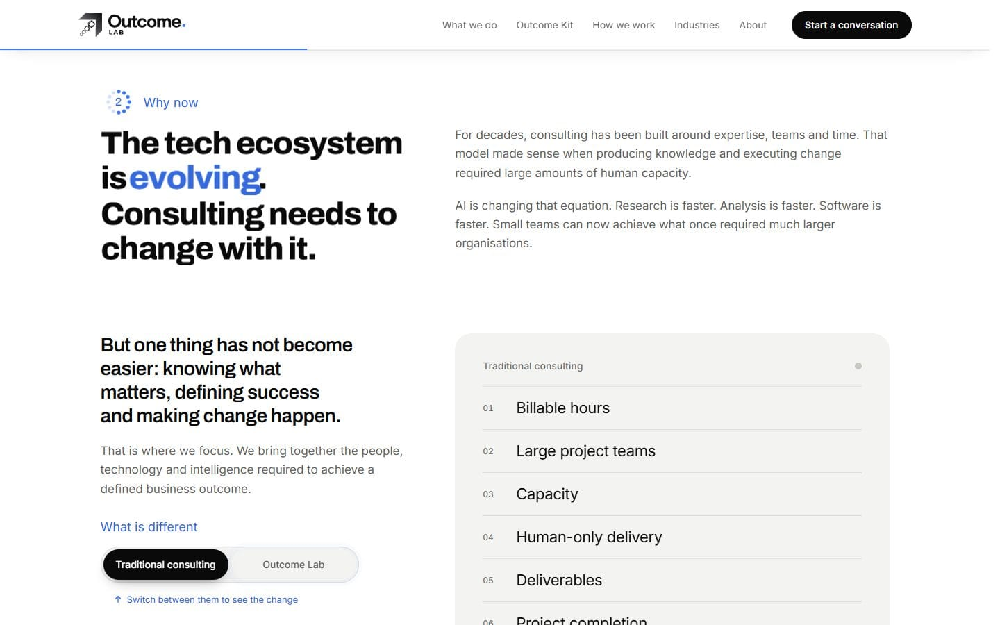 | 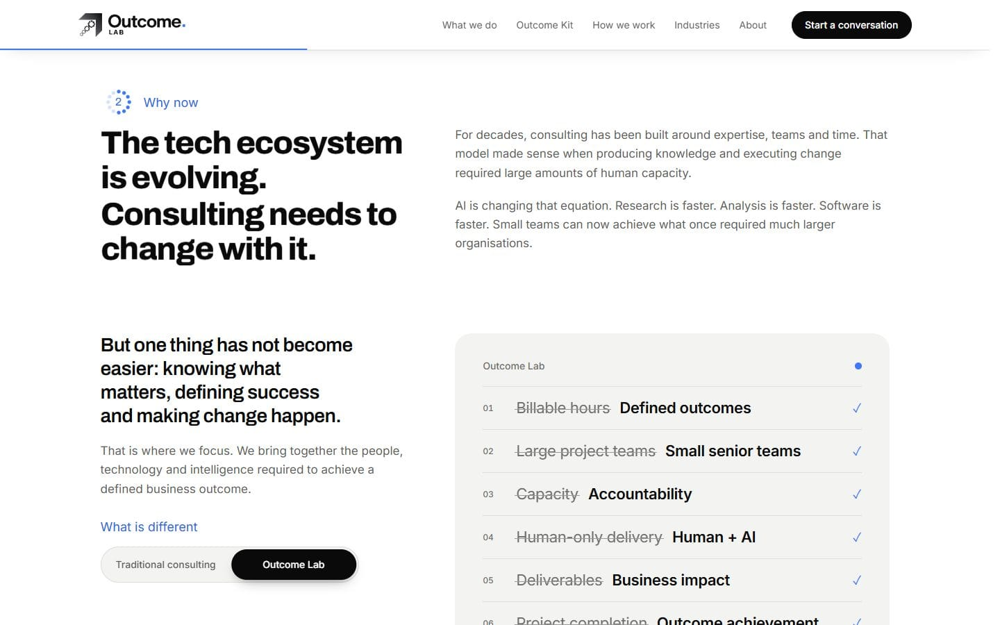 |
| **The switch, before.** The list as "Traditional consulting", with the hint under the switch. | **The switch, after.** Each row crossed out and replaced, with a blue tick. |
| 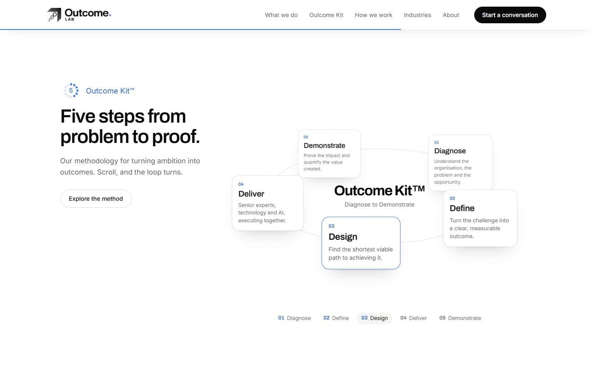 | 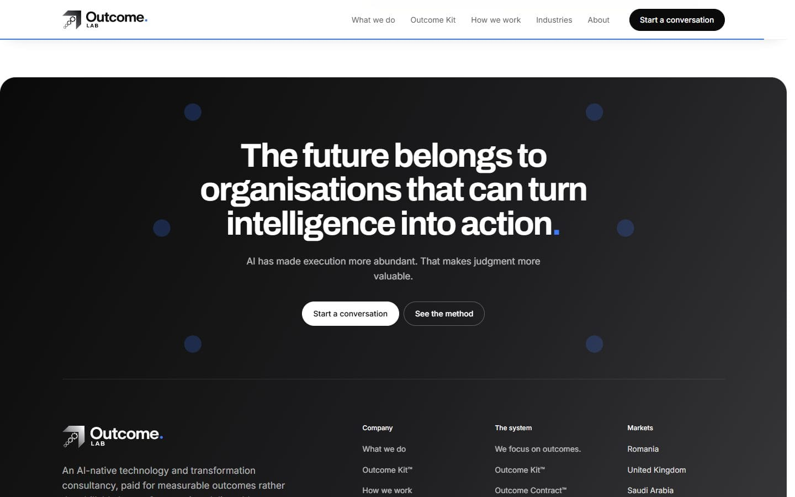 |
| **Outcome Kit orbit.** Step 3 in front, turned there by the scroll. | **Closing and footer.** The dark footer that ends every page. |

### Inner pages

| | |
|---|---|
| 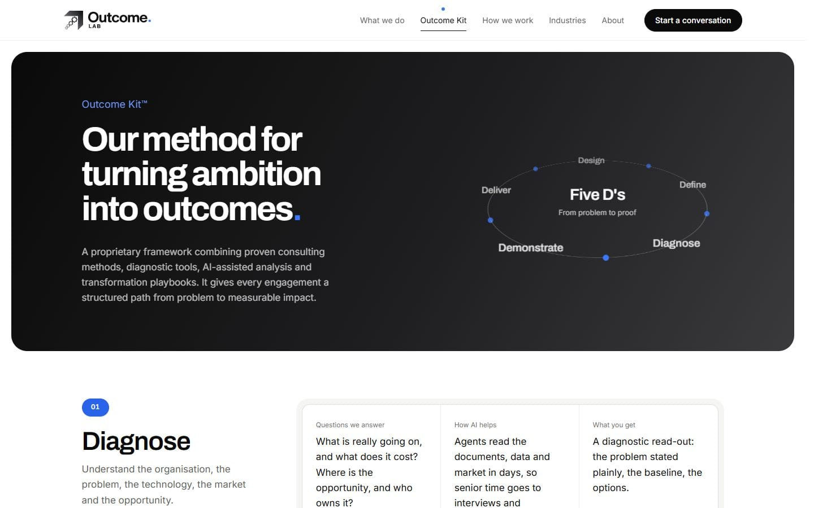 | 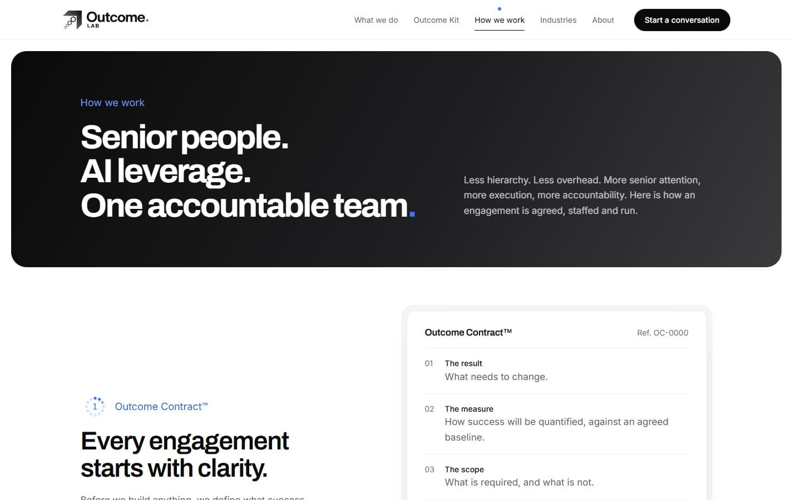 |
| **Outcome Kit.** The 3D orbit in the hero, then each step with its questions, the AI part and what the client gets. | **How we work.** The Outcome Contract drawn as a document. |

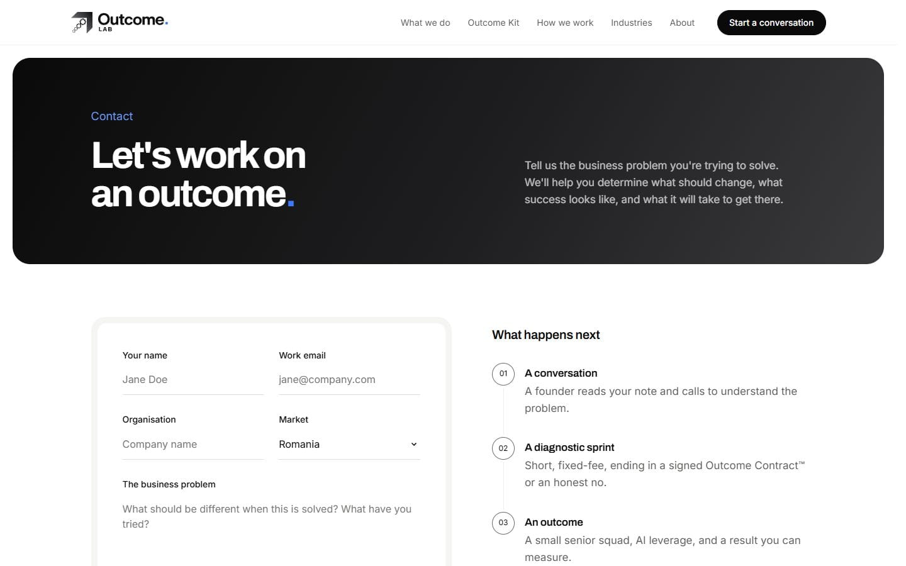

**Contact.** The form on the left and what happens next on the right.

### Mobile version

  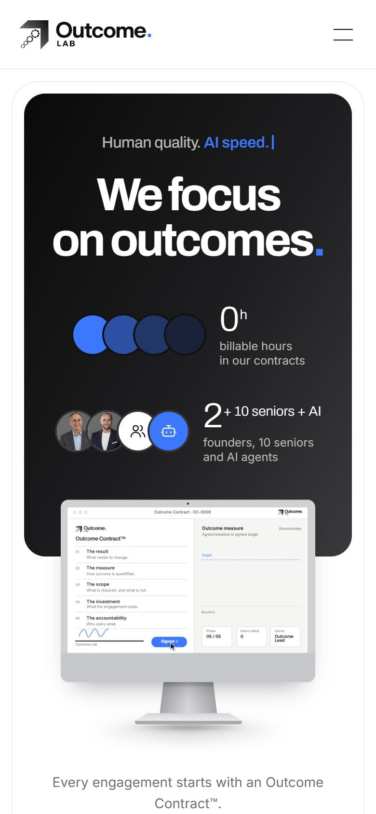
  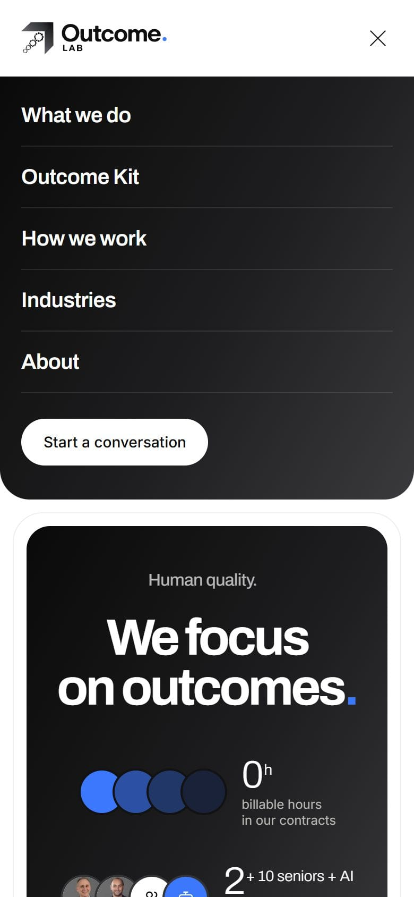
  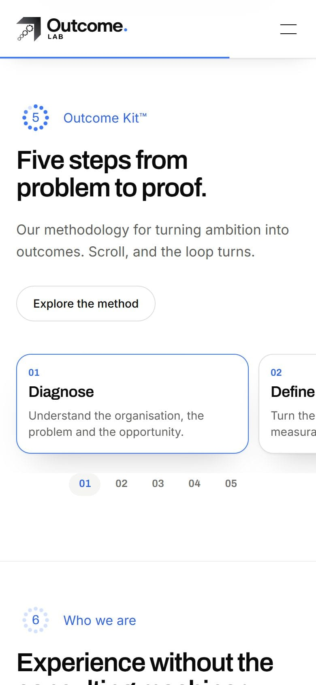
  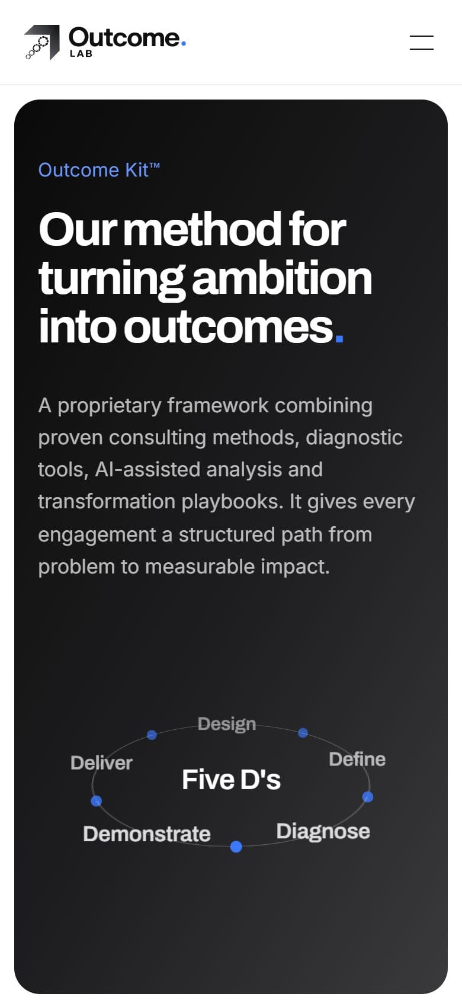

On phones the hero stacks and the computer plays its loop on its own, the
orbit becomes a swipeable carousel and the menu opens as a dark panel.

## Code samples

There are twelve files from the production code in [`code/`](code/), with a
short note on each one. They cover the scroll hero, the two orbits, the
comparison switch, the headline scramble, the motion system, the content file
and the share image.

## About maintenance

The site is live and I keep working on it. Since the redesign I have:

- added a senior advisors section on the home and about pages, and then one
  more advisor a day later;
- changed the hero headline to "We focus on outcomes" and put it on the share
  image too;
- brought the scroll hero down from 1280px to 1024px screens;
- fixed the scroll position when moving between pages;
- cleaned up the page titles and the share image URL.

Most of this starts with a message from the founders. I keep in touch with
them, we talk about what should change, and because all the text is in one
file a content change is small and quick to put live.

## Future development

- **Outcome Notes.** The first articles are already planned and listed as
  "forthcoming" on the site: "The billable hour has an AI problem", "AI
  transformation is an operating model problem" and "The five person team that
  replaces the twenty person project". The section is ready, so publishing one
  is a content change, not a code change.
- **The team section.** Updating the current members and adding new ones as
  the team grows.

## License note

This repository has selected parts of a commercial production project, for
portfolio and technical review only. It's not the full codebase. All rights
are reserved: please don't copy or reuse the code, the text, the brand or the
images without permission.
